# Habit Tracker

An offline-first Flutter app for organizing personal goals into folders and recording daily progress. Each folder has a monthly calendar where a date can be marked **completed**, **missed**, or left **unrecorded**. Users can add rich-text notes to a day and review per-folder monthly statistics, including completion rates and streaks.

The app is Arabic-first, with Arabic selected by default and English available in Settings. It targets Android and Windows. Folder data, daily entries, notes, and preferences are stored locally in SQLite; the app does not require an account or backend.

## Use Case Diagram


The diagram summarizes the intended user flows: managing folders, recording daily status and notes, viewing statistics, handling backups, and changing settings. It is a high-level overview rather than a complete feature checklist. The current implementation provides ZIP backup and restore; CSV/PDF export and a yearly heatmap shown in the diagram are not implemented.

## Screens

The screenshots below are shown in numeric order. They illustrate the app UI and include both empty states and populated examples.

### Screen 1 — Empty folder list

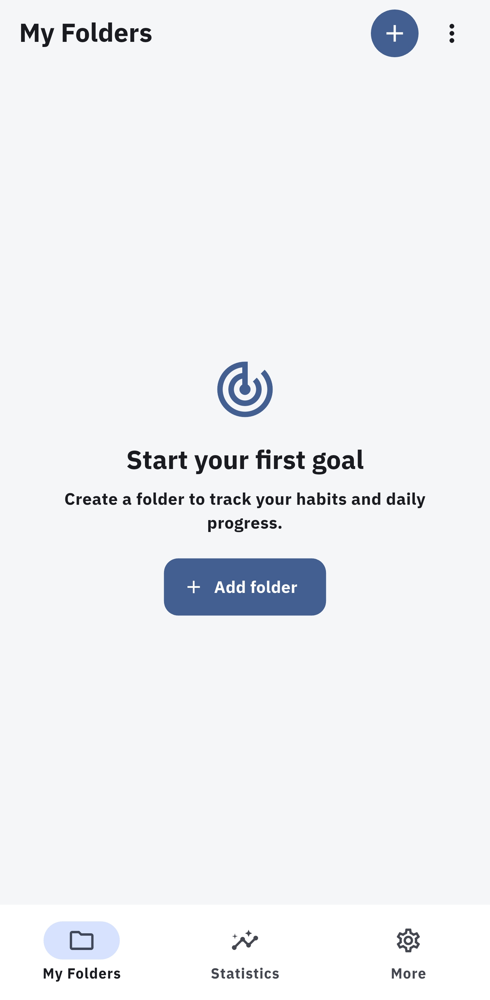

### Screen 2 — Create a folder

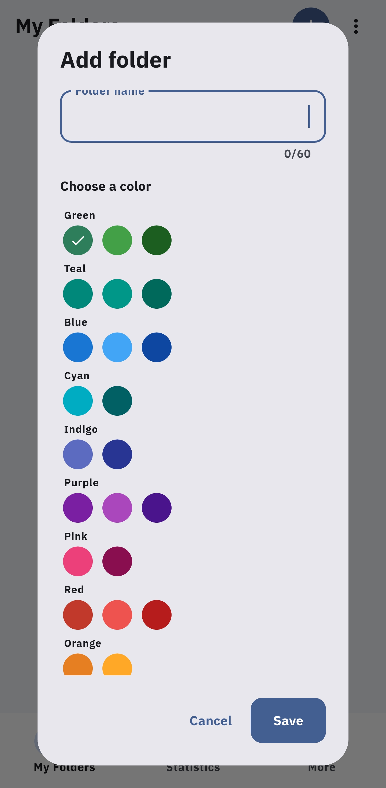

### Screen 3 — Browse folder icons

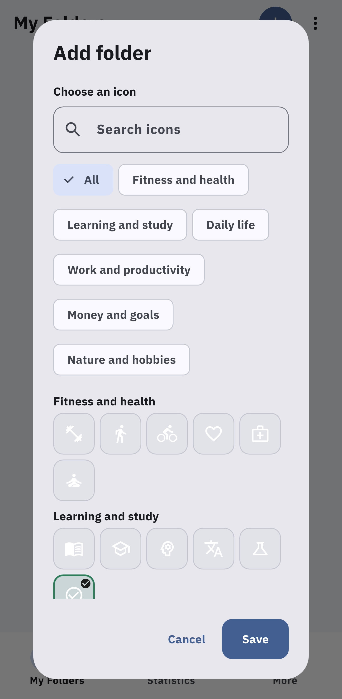

### Screen 4 — Choose a folder icon

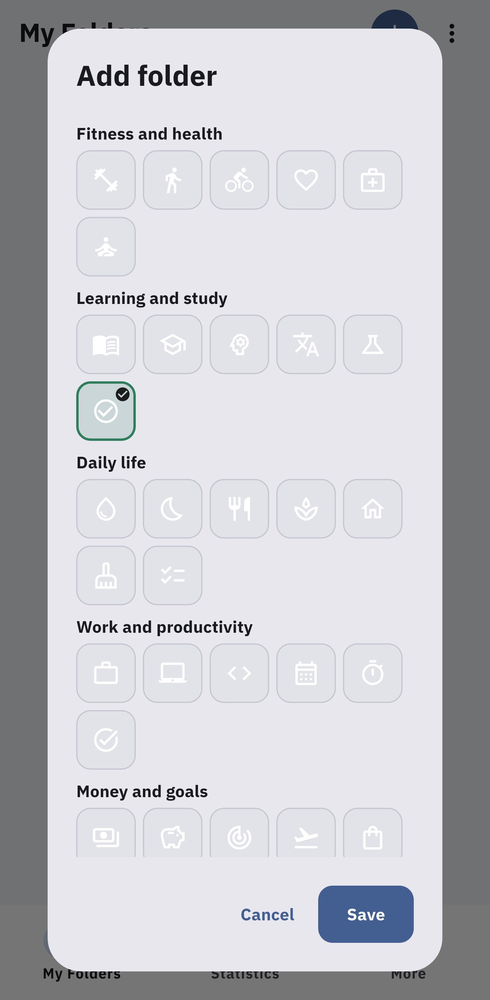

### Screen 5 — Folder list

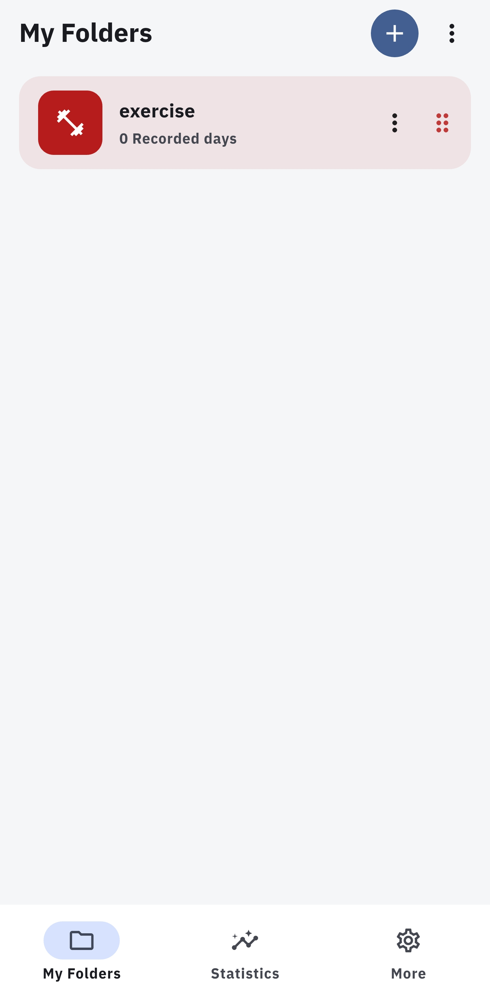

### Screen 6 — Folder actions

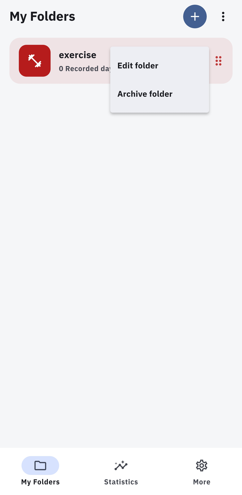

### Screen 7 — Monthly calendar with unrecorded dates

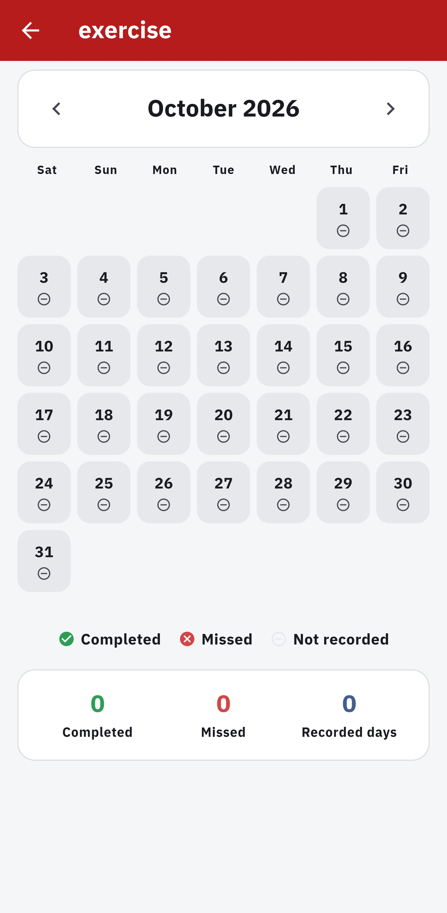

### Screen 8 — Daily details and notes editor

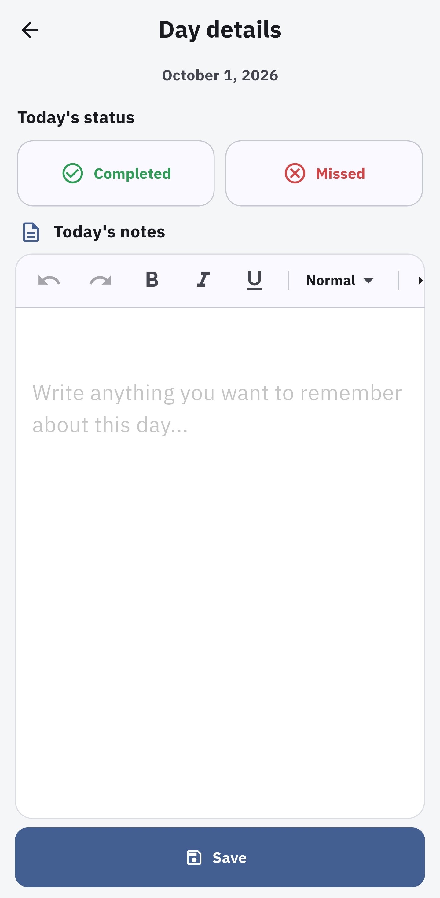

### Screen 9 — Monthly calendar with recorded statuses

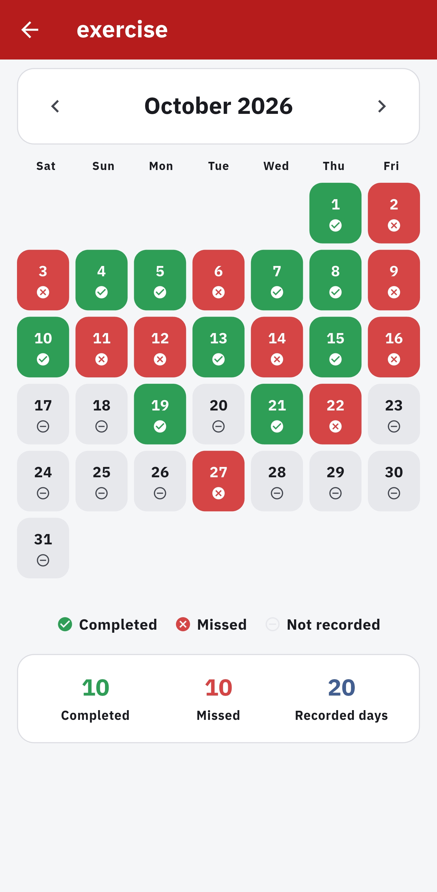

### Screen 10 — Statistics dashboard

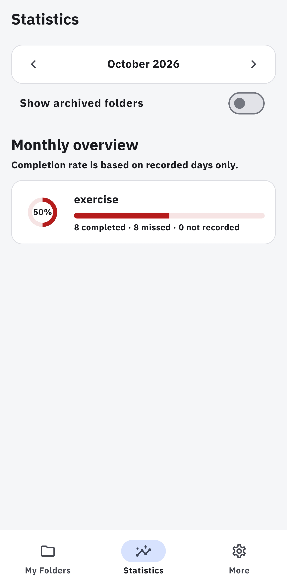

### Screen 11 — Folder monthly overview

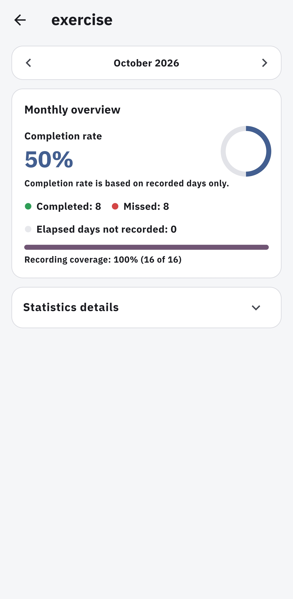

### Screen 12 — Detailed monthly statistics

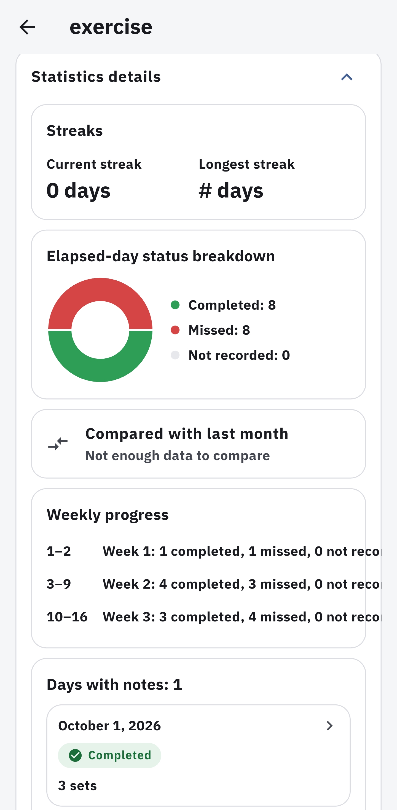

### Screen 13 — More options

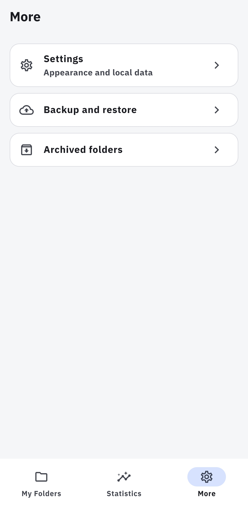

### Screen 14 — Light appearance settings

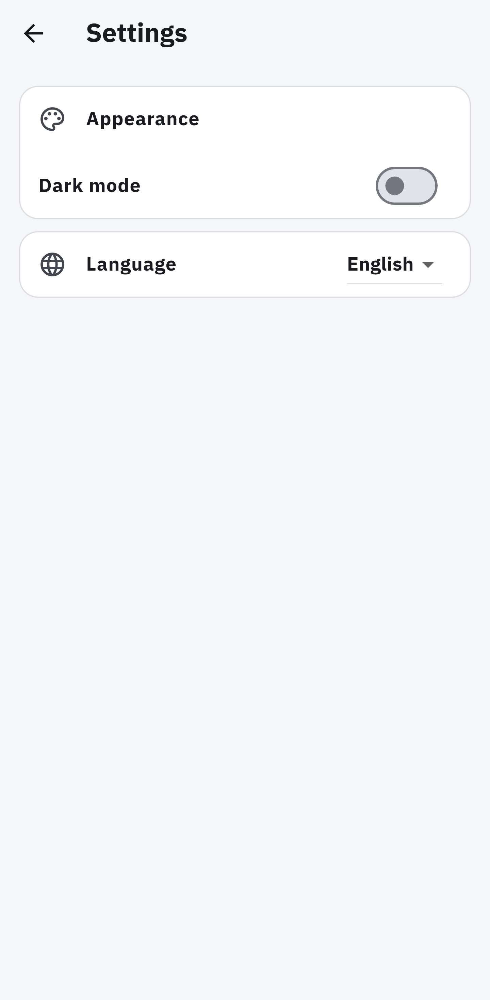

### Screen 15 — Dark appearance settings

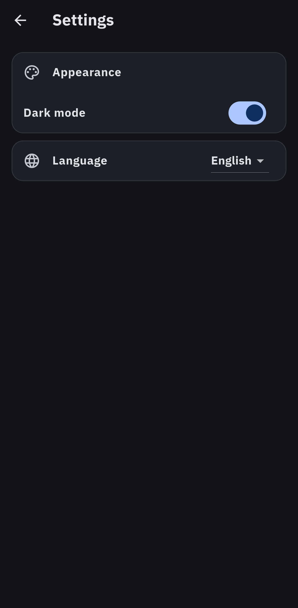

### Screen 16 — Language selection

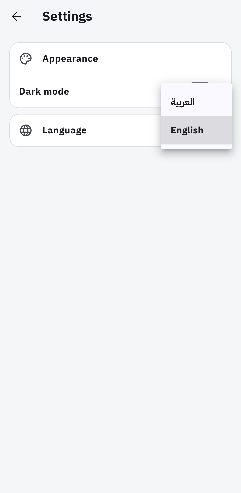

### Screen 17 — Backup and restore

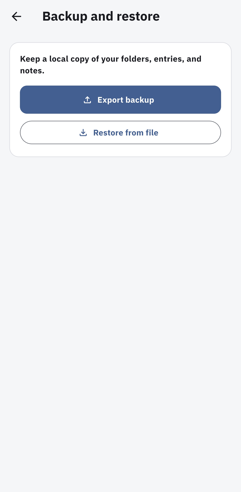

### Screen 18 — Archived folders

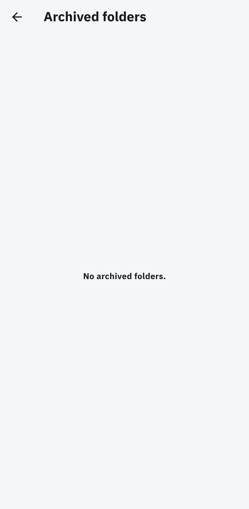

## Features

- **Folder management:** Create and edit goal folders, choose a color and icon, reorder folders, and archive or restore them. Archiving preserves the folder's entries.
- **Daily tracking:** Browse months in a Saturday-first calendar and record a day as completed or missed. A day with no status remains unrecorded; the app does not automatically mark missed days.
- **Daily notes:** Write rich-text notes with the Quill editor, including common text styles and lists. Changes in the day editor are committed when Save is pressed. Status-only and notes-only entries are supported.
- **Statistics:** Review per-folder monthly completion rates, elapsed-day recording coverage, current and longest streaks, completed/missed/unrecorded breakdowns, Saturday–Friday weekly summaries, notes by date, and comparison with the previous month. The dashboard keeps folder results separate and can include archived folders.
- **Backup and restore:** Export a versioned ZIP snapshot and restore it by replacing local data or importing folders separately. Replace restore creates a pre-restore safety backup; separate import assigns new folder and entry IDs.
- **Settings:** Select light or dark appearance and switch between Arabic (the default, right-to-left) and English (left-to-right). Preferences are stored locally.
- **Local storage:** SQLite stores folders, daily entries, notes, and app settings. The app has no account or server dependency.

### Current scope

The implemented backup format is ZIP. The CSV/PDF export and yearly heatmap named in the use case diagram are not currently available. Image attachments in notes and local reminders are also outside the current feature set.

## Getting Started

### Requirements

- Flutter SDK compatible with the Dart constraint in `pubspec.yaml` (`^3.11.0`).
- For Windows desktop builds, the Windows desktop development toolchain and Flutter's required plugin symlink support.
- For Android builds, the Android SDK and accepted Android SDK licenses.

### Run on Windows

From the project root:

```powershell
flutter pub get
flutter run -d windows
```

For Android, connect a device or start an emulator, then run `flutter devices` to find its identifier and use `flutter run -d <device-id>`.

## Architecture

The app is organized by feature, with shared infrastructure under `core/`:

1. **Presentation:** Flutter screens and widgets render folders, calendars, daily details, statistics, and settings.
2. **State and dependency injection:** Riverpod providers connect screens to repositories and expose database streams as reactive UI state.
3. **Data access:** Feature repositories own Drift queries and writes. `AppDatabase` defines the SQLite tables and database configuration.
4. **Domain logic:** Dart services handle date keys, calendar layout, Quill Delta validation, completion rates, streaks, and monthly/weekly summaries.
5. **Backup:** `BackupService` coordinates repositories with ZIP encoding and validation; restore updates local data transactionally.

For example, choosing a status in a folder calendar calls `EntryRepository.setStatus`, which persists the status in a database transaction while preserving existing notes. In the daily details editor, status and note changes stay in the editor until Save calls `EntryRepository.saveEntry` to commit both fields together. Riverpod database streams then update the affected screens.

The database currently uses three tables: `folders`, `daily_entries`, and `app_settings`. A daily entry is unique per folder and date. Dates are stored as `YYYY-MM-DD` calendar keys; notes are stored as Quill Delta JSON.

## Tech Stack

| Technology | Role |
| --- | --- |
| Flutter and Dart | Cross-platform UI and application logic for Android and Windows. |
| Riverpod (`flutter_riverpod`) | Dependency injection and reactive application state. |
| Drift (`drift`, `drift_flutter`) | Typed SQLite schema, queries, transactions, and platform database opening. |
| `go_router` | App routes and tab navigation. |
| `flutter_quill` | Rich-text daily notes and Delta documents. |
| `fl_chart` | Monthly status distribution charts. |
| `archive` | ZIP backup encoding and decoding. |
| `file_picker` | Backup file selection and export dialogs. |
| `path_provider` | App-local directory for the pre-restore safety backup. |
| `uuid` | Stable identifiers for folders and daily entries. |
| `intl` and Flutter localization | Locale-aware date formatting and Arabic/English app localization. |
| `package_info_plus` | App version recorded in backup metadata. |

The Arabic font (IBM Plex Sans Arabic) is bundled in `assets/fonts/` so the app does not need to download fonts at runtime.

## Project Structure

```text
.
├── android/                         Android platform project
├── assets/
│   ├── fonts/                       Bundled Arabic font and license
│   └── images/                      App icon, use case diagram, and screenshots
├── lib/
│   ├── app/                          App setup and route configuration
│   ├── core/
│   │   ├── backup/                   ZIP backup, validation, and restore
│   │   ├── database/                 Drift schema, database, and shared providers
│   │   ├── localization/
│   │   │   ├── arb/                  Arabic and English source strings
│   │   │   └── gen/                  Generated localization accessors
│   │   ├── theme/                    Themes and daily-status colors
│   │   └── utils/                    Date keys and validation helpers
│   ├── features/
│   │   ├── daily_entry/              Daily status and rich-text notes
│   │   ├── folders/                  Folder management and monthly calendar
│   │   ├── settings/                 Preferences and backup screens
│   │   └── statistics/               Statistics calculations and screens
│   └── main.dart                     Application entry point
├── test/                             Database, feature, domain, and backup tests
├── l10n.yaml                         Localization generation configuration
└── pubspec.yaml                      Package dependencies and Flutter assets
```

The project currently targets Android and Windows desktop; no web target is configured.
